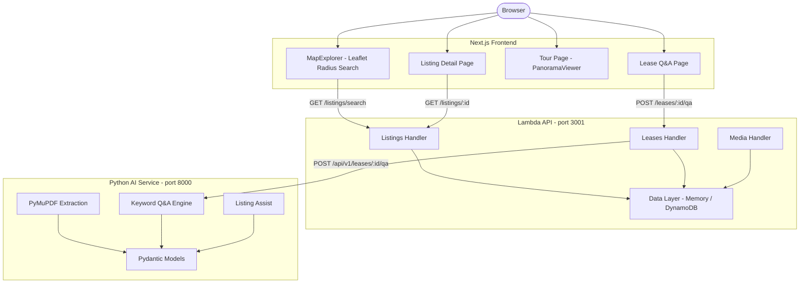

# Design Document: RentVision Platform

## Overview

RentVision is a serverless, monorepo web platform for discovering and evaluating rental properties in Addis Ababa, Ethiopia. The system has four feature domains implemented across three service layers:

- **Frontend** (`apps/web`): Next.js 16 / React 19 App Router with Leaflet maps and Pannellum 360° tours.
- **API** (`services/api`): TypeScript AWS Lambda handlers with in-memory and DynamoDB data stores.
- **AI Service** (`services/ai`): Python HTTP server using PyMuPDF and Pydantic for lease extraction and Q&A.

The platform is fully functional locally with a memory-backed data layer and an HTTP development server for each service.

---

## Architecture



---

## Components and Interfaces

### Frontend Components

#### `MapExplorer` (`apps/web/src/components/MapExplorer.tsx`)
- Manages search state: `lat`, `lng`, `radiusKm`, `propertyType`, `selectedId`
- On mount and state change: calls `searchListings()` from `lib/api.ts`
- Dynamically imports Leaflet (avoids SSR issues)
- Renders a Leaflet map with radius circle and CircleMarkers per listing
- Sidebar renders listing cards; clicking a card or marker sets `selectedId`

#### `PanoramaViewer` (`apps/web/src/components/PanoramaViewer.tsx`)
- Accepts `scenes: TourScene[]` and `defaultSceneId: string`
- Dynamically imports Pannellum scripts via `import()`
- Configures multi-scene Pannellum viewer with hotspots
- Cleans up via `viewer.destroy()` on unmount

#### Pages
- `/` → `MapExplorer` (full-screen map + sidebar)
- `/listings/[id]` → Listing detail, links to tour and lease Q&A
- `/listings/[id]/tour` → `PanoramaViewer` with `getTour(id)` scenes
- `/listings/[id]/lease` → Lease Q&A form, calls `askLeaseQuestion()`

### API Lambda Handlers (`services/api/src/handlers/`)

#### Listings Handler
Routes: `GET /listings`, `POST /listings`, `GET /listings/{id}`, `GET /listings/search`

Key functions:
- `handleCreateListing`: validates body, computes geohash via `encodeGeohash()`, assigns UUID
- `handleGeoSearch`: queries candidate geohashes via `getBoundingBoxGeohashes()`, filters by Haversine distance
- `handleGetListing`: fetches from data layer by ID
- `handleListListings`: paginated list with `nextToken` cursor

#### Leases Handler
Routes: `POST /leases/upload-url`, `GET /leases/{id}`, `POST /leases/{id}/qa`

Key functions:
- `handleGenerateUploadUrl`: validates PDF MIME type and file size (≤25MB), creates S3 presigned URL, stores Lease record
- `handleLeaseQA`: validates question, fetches lease from data layer, calls AI service via `queryAiService()`, returns `LeaseQAResponse`
- `queryAiService()`: HTTP call to AI service with 5-second timeout; returns fallback answer on error/timeout

#### Media Handler
Routes: `POST /media/upload-url`, `GET /media/download-url`

Key functions:
- `handleGenerateUploadUrl`: validates media/content types, generates S3 presigned PUT URL with path `listings/{id}/{type}s/{uuid}_{name}`
- `handleGenerateDownloadUrl`: generates S3 presigned GET URL for a given `fileKey`

### Data Layer (`services/api/src/data/`)

Two storage modes selected via `DATA_STORE=memory` environment variable:
- **Memory**: `Map<string, Listing | Lease>` for local development, seeded with 6 demo listings and leases on startup
- **DynamoDB**: `DynamoDBDocumentClient` with geohash GSI (`geoIndex`) and status GSI (`statusIndex`)

Local mode also provides `putLocalObject` / `getLocalObject` for simulating S3.

### Utility Modules (`services/api/src/utils/`)

#### Geohash (`geohash.ts`)
- `encodeGeohash(lat, lng, precision)`: Base32 bit-interleaving encode
- `decodeGeohashBbox(hash)`: decode to bounding box
- `decodeGeohash(hash)`: decode to center coordinates
- `getNeighborGeohashes(hash)`: 9-cell neighborhood
- `getBoundingBoxGeohashes(lat, lng, radiusKm, precision)`: grid scan of geohash cells covering a radius

#### Distance (`distance.ts`)
- `haversineDistance(lat1, lng1, lat2, lng2)`: great-circle distance in km

#### Response (`response.ts`)
- `successResponse(data, status)`: `{ success: true, data, metadata }`
- `errorResponse(code, message, status)`: `{ success: false, error: { code, message }, metadata }`
- `createResponse(status, body)`: raw response with CORS headers

### AI Service (`services/ai/src/rentvision_ai/`)

#### Models (`models.py`)
Pydantic v2 models:
- `LeaseExtractedData`: `start_date`, `end_date`, `monthly_rent`, `deposit`, `terms`, `landlord_name`, `tenant_name`
- `LeaseExtractionResult`: `lease_id`, `page_count`, `text`, `extracted: LeaseExtractedData`
- `LeaseQAAnswer`: `lease_id`, `question`, `answer`, `confidence` (0–1), `source_page`
- `ListingAssistRequest` / `ListingAssistResponse`

#### Extraction (`extraction.py`)
- `extract_pdf_pages(bytes)`: opens PDF with `fitz.open()`, returns list of page text strings
- `extract_fields(text)`: regex patterns for date, rent, deposit, party names, terms
- `store_extracted_text(lease_id, text, pages)`: stores `LeaseExtractionResult` in `LEASE_STORE` dict
- `get_lease(lease_id)`: returns stored result or falls back to `SAMPLE_LEASE_TEXT`

#### Q&A Engine (`qa.py`)
- `answer_question(lease_id, question)`: tokenizes question, scores sentences by overlap, returns top-ranked sentence

#### HTTP Server (`server.py`)
- `ThreadingHTTPServer` on `127.0.0.1:8000`
- Routes: `GET /health`, `GET /api/v1/leases/{id}`, `POST /api/v1/leases/{id}/extract`, `POST /api/v1/leases/{id}/qa`, `POST /api/v1/listings/assist`
- Returns 400 on `ValidationError`, 404 on unknown route

---

## Data Models

### Listing (TypeScript)
```typescript
interface Listing {
  listingId: string;       // UUID
  title: string;
  description: string;
  price: number;           // ETB
  currency: 'ETB' | 'USD';
  propertyType: 'apartment' | 'house' | 'studio' | 'commercial' | 'villa';
  status: 'active' | 'inactive' | 'pending' | 'rented';
  latitude: number;        // [-90, 90]
  longitude: number;       // [-180, 180]
  geohash: string;         // precision-5 Base32
  address: { street, city, subcity, woreda };
  bedrooms: number;
  bathrooms: number;
  areaSqm: number;
  amenities: string[];
  mediaKeys: string[];     // S3 object keys
  panoramaKeys: string[];  // S3 object keys
  landlordId: string;
  createdAt: string;       // ISO 8601
  updatedAt: string;       // ISO 8601
}
```

### Lease (TypeScript)
```typescript
interface Lease {
  leaseId: string;         // UUID
  listingId: string;
  fileName: string;
  fileKey: string;         // S3 key
  fileSize: number;        // bytes
  mimeType: string;        // 'application/pdf'
  status: 'uploaded' | 'processing' | 'extracted' | 'failed';
  uploadedBy: string;
  extractedData?: LeaseExtractedData;
  createdAt: string;
  updatedAt: string;
}
```

### LeaseExtractionResult (Python / Pydantic)
```python
class LeaseExtractionResult(BaseModel):
    lease_id: str
    page_count: int
    text: str
    extracted: LeaseExtractedData  # start_date, end_date, monthly_rent, deposit, terms, landlord_name, tenant_name
```

### TourScene (TypeScript)
```typescript
interface TourScene {
  id: string;
  title: string;
  imageUrl: string;
  hotspots: Array<{ id, pitch, yaw, text, targetSceneId? }>;
}
```

---

## Correctness Properties

*A property is a characteristic or behavior that should hold true across all valid executions of a system-essentially, a formal statement about what the system should do. Properties serve as the bridge between human-readable specifications and machine-verifiable correctness guarantees.*

---

**Property 1: Listing creation round-trip**
*For any* valid listing payload (non-empty title, positive price, latitude in [-90,90], longitude in [-180,180]), creating the listing via the handler and then fetching it by the returned `listingId` should return a listing with matching fields, `status` of `active`, and a geohash of exactly 5 characters.
**Validates: Requirements 1.1, 1.3**

---

**Property 2: Invalid listing inputs are rejected**
*For any* listing creation payload that is missing a required field or has an out-of-range value (e.g., `latitude > 90`, `price < 0`), the handler should return HTTP 400 with `error.code === 'VALIDATION_ERROR'`.
**Validates: Requirements 1.2**

---

**Property 3: Listing list count consistency**
*For any* number of listings created and stored in the memory store, fetching `GET /listings` should return a response where `data.count === data.items.length` and all items have `status === 'active'`.
**Validates: Requirements 1.5**

---

**Property 4: Geo-search radius containment and sort order**
*For any* set of listings stored in memory and any valid search center `(lat, lng, radiusKm)`, all items returned by `GET /listings/search` should have `distanceKm <= radiusKm` and the items should be sorted in non-decreasing order of `distanceKm`.
**Validates: Requirements 2.1, 2.4**

---

**Property 5: Geohash encoding output contract**
*For any* latitude in [-90, 90], longitude in [-180, 180], and precision in [1, 12], `encodeGeohash(lat, lng, precision)` should return a string of exactly `precision` characters drawn from the Base32 alphabet `0-9bcdefghjkmnpqrstuvwxyz`.
**Validates: Requirements 2.6**

---

**Property 6: Geohash encode-decode round-trip**
*For any* latitude in [-90, 90] and longitude in [-180, 180], encoding to a geohash at precision P and then decoding should produce center coordinates within the precision cell's tolerance, and re-encoding those center coordinates at precision P should produce the same geohash.
**Validates: Requirements 2.7**

---

**Property 7: Tour scene structure completeness**
*For any* listing ID passed to `getTour()`, every `TourScene` in the returned `scenes` array should have a non-empty `id`, `title`, and `imageUrl`, and every hotspot in `hotspots` should have defined `pitch`, `yaw`, and `text` fields.
**Validates: Requirements 3.4**

---

**Property 8: Lease upload round-trip**
*For any* valid lease upload request (PDF mime type, fileSize in (0, 25MB]), the handler should return HTTP 201 with a `leaseId`, and a subsequent `GET /leases/{leaseId}` should return a lease record with a matching `listingId`.
**Validates: Requirements 4.1**

---

**Property 9: Lease field extraction from text**
*For any* lease text string that contains recognizable patterns (e.g., `"Monthly Rent: 45000"`, `"Landlord: Hana Bekele"`), `extract_fields(text)` should return a `LeaseExtractedData` where the extracted numeric fields match the values in the text and extracted string fields match the names.
**Validates: Requirements 5.5**

---

**Property 10: Pydantic model serialization round-trip**
*For any* instance of `LeaseExtractionResult`, `LeaseQAAnswer`, or `ListingAssistResponse`, calling `model.model_dump()` and then `Model.model_validate(data)` should produce a model instance equal to the original.
**Validates: Requirements 5.6**

---

**Property 11: Media upload file key path structure**
*For any* combination of valid `listingId`, `fileName`, `mediaType` (photo/panorama/document), and valid `contentType`, the `fileKey` returned by the media upload handler should match the pattern `listings/{listingId}/{mediaType}s/{uuid}_{sanitizedFileName}`.
**Validates: Requirements 6.1**

---

**Property 12: Response shape invariant**
*For any* successful handler response, `successResponse(data, status).body` when parsed should have `success === true`, a defined `data` field, and a defined `metadata.timestamp`. *For any* error handler response, `errorResponse(code, message, status).body` when parsed should have `success === false` and `error.code` matching the input code.
**Validates: Requirements 1.1, 1.2, 2.1, 4.1, 6.1**

---

## Error Handling

### API Lambda Handlers
- All handlers wrap logic in try/catch; unhandled errors return HTTP 500 with `INTERNAL_ERROR`.
- All input validation returns HTTP 400 with `VALIDATION_ERROR` and a field-specific message.
- Missing resources return HTTP 404 with `NOT_FOUND`.
- All responses include CORS headers (`Access-Control-Allow-Origin: *`).

### AI Service
- `ValidationError` from Pydantic returns HTTP 400 with `error: validation_error` and structured details.
- Unknown routes return HTTP 404 with `error: not_found`.
- PDF parse errors propagate naturally; clients should handle extraction failures.

### Frontend
- API errors are caught in `useEffect` / form handlers and displayed in `<p className="error">` elements.
- `MapExplorer` shows a specific hint to start the local API when search fails.
- Lease Q&A disables the submit button during in-flight requests to prevent double-submission.

---

## Testing Strategy

### Unit Testing (Jest for TypeScript, pytest for Python)
Unit tests verify specific examples and integration points:
- `services/api/src/utils/geohash.test.ts`: encode/decode at known coordinates, neighbor cells, bounding box coverage
- `services/api/src/utils/distance.test.ts`: zero distance for same point, known city-pair distance
- `services/api/src/utils/response.test.ts`: CORS headers, `successResponse` shape, `errorResponse` shape
- `services/api/src/handlers/listings.test.ts`: list seeded data, create+fetch round-trip, radius search, missing params
- `services/api/src/handlers/leases.test.ts`: upload URL creation, non-PDF rejection
- `services/api/src/handlers/media.test.ts`: panorama upload URL path, download URL
- `services/ai/tests/test_qa.py`: field extraction, Q&A keyword match, listing assist location injection

### Property-Based Testing
**TypeScript**: [fast-check](https://github.com/dubzzz/fast-check) (version `^3.19.0`) — generates random inputs across the full valid domain.
**Python**: [hypothesis](https://hypothesis.readthedocs.io/) (version `^6.100.0`) — strategy-based generation for Python models.

Each property-based test runs a minimum of **100 iterations**.

Each property test is tagged with the following format:
`// Feature: rentvision-platform, Property {N}: {property_text}` (TypeScript)
`# Feature: rentvision-platform, Property {N}: {property_text}` (Python)

| Property | Test Location | Framework |
|---|---|---|
| 1: Listing creation round-trip | `services/api/src/handlers/listings.property.test.ts` | fast-check |
| 2: Invalid listing inputs rejected | `services/api/src/handlers/listings.property.test.ts` | fast-check |
| 3: Listing list count consistency | `services/api/src/handlers/listings.property.test.ts` | fast-check |
| 4: Geo-search radius containment and sort | `services/api/src/handlers/listings.property.test.ts` | fast-check |
| 5: Geohash encoding output contract | `services/api/src/utils/geohash.property.test.ts` | fast-check |
| 6: Geohash encode-decode round-trip | `services/api/src/utils/geohash.property.test.ts` | fast-check |
| 7: Tour scene structure completeness | `apps/web/src/lib/tours.property.test.ts` | fast-check |
| 8: Lease upload round-trip | `services/api/src/handlers/leases.property.test.ts` | fast-check |
| 9: Lease field extraction from text | `services/ai/tests/test_extraction_property.py` | hypothesis |
| 10: Pydantic model serialization round-trip | `services/ai/tests/test_models_property.py` | hypothesis |
| 11: Media upload file key path structure | `services/api/src/handlers/media.property.test.ts` | fast-check |
| 12: Response shape invariant | `services/api/src/utils/response.property.test.ts` | fast-check |
