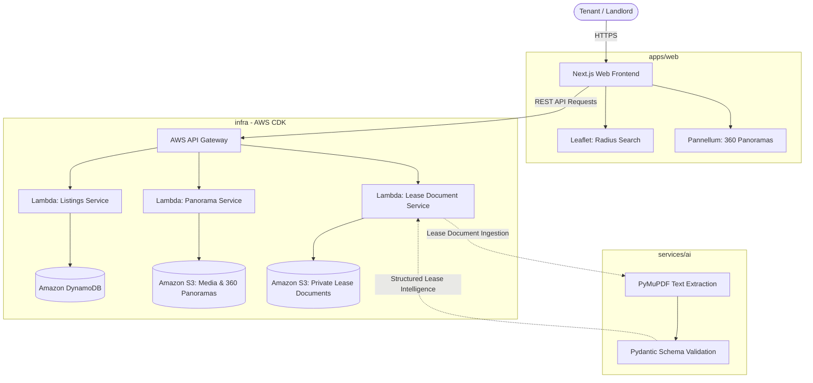

# RentVision

A web-based rental property platform tailored for the Ethiopian real estate market, designed to enhance property transparency through interactive mapping, immersive 360° virtual inspections, and intelligent document processing.

---

## 1. Project Title and Overview

Finding, evaluating, and securing rental properties in Ethiopia often suffers from fragmented information, inaccurate location descriptions, and non-transparent lease agreements. Prospective tenants typically rely on informal brokers and physical visits to gauge property conditions, resulting in high transaction costs and wasted time.

**RentVision** addresses these challenges by consolidating property discovery and evaluation into a unified, modern web application. By combining map-based spatial search, WebGL-driven 360° virtual tours with interactive room hotspots, and automated document analysis for rental agreements, RentVision modernizes the tenant and landlord experience.

This repository is structured as a monorepo containing the web frontend, serverless API definitions, Python-based AI document extraction service, and AWS CDK infrastructure definitions.

---

## 2. Key Features

RentVision encompasses four primary feature domains. In this repository initialization phase, foundational architectures and environment configurations are in place; functional business logic and live services will be implemented in subsequent phases.

- **Property Listings & Metadata**: Structured cataloging of residential and commercial properties, including location, pricing, availability, and multi-asset media galleries. *(Planned)*
- **Map-Based Radius Search**: Visual spatial exploration powered by Leaflet, enabling users to define a geographic center and distance radius to discover nearby rental options. *(Planned)*
- **Interactive 360° Property Panoramas**: Immersive, WebGL-powered panoramic property tours utilizing Pannellum, featuring clickable hotspots to navigate between rooms seamlessly. *(Planned)*
- **AI Listing Assistance & Lease Q&A**: Python-powered document processing using PyMuPDF to extract text from PDF lease contracts and Pydantic for schema validation, providing structured lease comprehension and automated listing guidance. *(Planned)*

---

## 3. Technology Stack

The platform is built on modern, cloud-native technologies:

| Layer | Technology | Role |
| :--- | :--- | :--- |
| **Frontend Framework** | [Next.js](https://nextjs.org/) (v16.4) & [React](https://react.dev/) (v19.3) | App Router architecture, server-side rendering, and responsive UI |
| **Frontend Language** | [TypeScript](https://www.typescriptlang.org/) (v5.x) | Static typing across components and data contracts |
| **Spatial Mapping** | [Leaflet](https://leafletjs.com/) (v1.9) | Client-side interactive maps and radius search visualizations |
| **Virtual Tours** | [Pannellum](https://pannellum.org/) (v2.5) | WebGL-based 360° equirectangular panorama viewer with hotspot navigation |
| **Backend Compute** | [AWS Lambda](https://aws.amazon.com/lambda/) (Node.js/TypeScript) | Serverless, event-driven compute handlers |
| **API Ingress** | [AWS API Gateway](https://aws.amazon.com/api-gateway/) | HTTP/REST endpoints, authentication, and CORS management |
| **Application Database** | [Amazon DynamoDB](https://aws.amazon.com/dynamodb/) | Scalable, low-latency NoSQL database for properties and users |
| **Media & Document Storage** | [Amazon S3](https://aws.amazon.com/s3/) | Segregated object storage for public media and private lease documents |
| **AI & Document Processing** | [Python](https://www.python.org/) (v3.12) | Environment for data modeling and document parsing |
| **Data Validation** | [Pydantic](https://docs.pydantic.dev/) (v2.7+) | Strict schema enforcement and runtime data validation |
| **Document Parsing** | [PyMuPDF](https://pymupdf.readthedocs.io/) (v1.24+) | High-performance text and layout extraction from lease agreements |
| **Infrastructure as Code** | [AWS CDK](https://aws.amazon.com/cdk/) (v2.180+) with TypeScript | Declarative cloud resource definitions and reproducible deployments |

---

## 4. Architecture

RentVision adopts a serverless, decoupled architecture. The Next.js frontend delivers the user interface and client-side rendering for maps and 360° panoramas. API Gateway and Lambda orchestrate business logic, DynamoDB persists operational data, S3 stores media and documents, and the Python AI module processes lease contracts.



---

## 5. Repository Structure

This monorepo consolidates all project components under a single version-controlled repository:

```text
rentvision/
├── apps/
│   └── web/                 # Next.js frontend application (React, TypeScript, Leaflet, Pannellum)
├── services/
│   ├── api/                 # Serverless backend service architecture and Lambda handler specs
│   └── ai/                  # Python AI and document processing service (Pydantic, PyMuPDF)
├── shared/
│   └── contracts/           # Cross-service API schemas, data models, and integration interfaces
├── infra/
│   ├── bin/                 # AWS CDK application entrypoint
│   ├── lib/                 # AWS CDK stack definitions (DynamoDB, S3, API Gateway, Lambda)
│   └── test/                # Infrastructure unit and assertion tests
├── docs/                    # Architecture diagrams and technical documentation
├── tests/                   # Cross-service integration and end-to-end tests
├── .github/
│   └── workflows/           # Continuous Integration and deployment workflow definitions
├── .env.example             # Safe placeholder configuration template
├── render.yaml              # Optional Render Blueprint (three-service demo deployment)
├── .gitignore               # Exclusions for dependencies, build artifacts, and secrets
└── README.md                # Project documentation
```

---

## 6. Prerequisites

Ensure the following tools are installed on your local development machine:

- **Git** (v2.40+; verified with v2.55.0) — [Download Git](https://git-scm.com/downloads)
- **Node.js** (v20+ or v24 LTS; verified with v24.20.0) — [Download Node.js](https://nodejs.org/)
- **npm** (v10+; verified with v11.19.0) — Included with Node.js
- **Python** (v3.12+; verified with v3.12.13) — [Download Python](https://www.python.org/downloads/)
- **AWS CLI v2** (for cloud infrastructure management) — [Install AWS CLI](https://aws.amazon.com/cli/)
- **AWS CDK CLI** (v2.x) — Installed globally via `npm install -g aws-cdk` or executed via `npx aws-cdk`

---

## 7. Getting Started

Follow these numbered steps to set up and run the project locally on Windows (PowerShell):

### 1. Clone the Repository

```powershell
git clone <repository-url> rentvision
cd rentvision
```

### 2. Configure Environment Variables

Create a local environment file from the provided template:

```powershell
Copy-Item .env.example .env
```

### 3. Run the Frontend Application (`apps/web`)

```powershell
# Navigate to web application directory
cd apps/web

# Install frontend dependencies
npm install

# Start the local development server
npm run dev
```

Open [http://localhost:3000](http://localhost:3000) in your browser to view the application.

### 4. Configure the Python AI Service (`services/ai`)

In a new terminal:

```powershell
# Navigate to AI service directory
cd services/ai

# Create a virtual environment
python3.12 -m venv .venv

# Activate the virtual environment
.\.venv\Scripts\Activate.ps1

# Upgrade pip and install dependencies
python -m pip install --upgrade pip
pip install -r requirements.txt
```

### 5. Initialize the Infrastructure Workspace (`infra`)

In a new terminal:

```powershell
# Navigate to infrastructure directory
cd infra

# Install CDK dependencies
npm install

# Synthesize CloudFormation template
npx cdk synth
```

---

## 8. Configuration

Application configuration is managed through environment variables. The `.env.example` file contains documented placeholders:

- **AWS Settings**: `AWS_REGION`, `AWS_ACCOUNT_ID`, `CDK_DEFAULT_REGION`, `CDK_DEFAULT_ACCOUNT`
- **Frontend Variables**:
  - `NEXT_PUBLIC_APP_URL`: Base URL for the client application.
  - `NEXT_PUBLIC_API_BASE_URL`: Base endpoint for API Gateway routes.
  - `NEXT_PUBLIC_MAP_TILE_URL`: Tile server URL for Leaflet maps (default: OpenStreetMap).
  - `NEXT_PUBLIC_DEFAULT_LATITUDE`, `NEXT_PUBLIC_DEFAULT_LONGITUDE`: Default geographic coordinates (Addis Ababa, Ethiopia).
- **Backend & Storage**:
  - `DYNAMODB_PROPERTIES_TABLE`, `DYNAMODB_USERS_TABLE`, `DYNAMODB_LEASES_TABLE`
  - `S3_PROPERTY_MEDIA_BUCKET`, `S3_LEASE_DOCUMENTS_BUCKET`
- **AI Service**:
  - `AI_SERVICE_HOST`, `AI_SERVICE_PORT`, `MAX_DOCUMENT_UPLOAD_MB`
- **Render Blueprint** (set automatically by `render.yaml`):
  - `NEXT_PUBLIC_API_BASE_URL`, `NEXT_PUBLIC_AUTH_MODE`, `API_INTERNAL_URL`, `RENTVISION_AI_BASE_URL`
  - `DATA_STORE`, `API_LOCAL_MODE`, `AUTH_TOKEN_SECRET`

Copy `.env.example` to `.env` or `.env.local` for local development. Never commit real credentials, access keys, or secret tokens to version control.

---

## 9. Development and Testing

The following commands are configured and available in the current codebase:

### Frontend (`apps/web`)

```powershell
# Run Next.js linter
npm run lint

# Compile and validate production build
npm run build

# Start production server (following build)
npm run start
```

### AI Service (`services/ai`)

```powershell
# Run tests (with virtual environment activated)
pytest
```

### Infrastructure (`infra`)

```powershell
# Synthesize CloudFormation template
npx cdk synth

# Compare local CDK definitions with deployed stack
npx cdk diff
```

---

## 10. Deployment

The primary production deployment strategy relies on AWS Cloud Development Kit (CDK) for repeatable infrastructure provisioning:

1. **Prerequisites for Deployment**:
   - An active AWS account with administrative permissions for IAM, CloudFormation, DynamoDB, S3, API Gateway, and Lambda.
   - AWS credentials configured locally or within the CI/CD deployment environment.
2. **AWS CDK Bootstrap**:
   ```powershell
   npx cdk bootstrap aws://<ACCOUNT_ID>/<REGION>
   ```
3. **Deploy Infrastructure**:
   ```powershell
   npx cdk deploy
   ```
4. **Current Status**:
   - Infrastructure definitions and resource stacks are in their initial staging phase.
   - Automated deployment pipelines and live AWS provisioning will be activated once service endpoints and data models are implemented.

### Render Blueprint (optional demo deployment)

The repository also includes [`render.yaml`](render.yaml) for a self-contained public demo on [Render](https://render.com). This path does not require AWS; it deploys three free-tier web services in the `frankfurt` region:

- `rentvision-web` — Next.js frontend and the only browser-facing origin.
- `rentvision-api` — Node/TypeScript API using the in-memory demo store.
- `rentvision-ai` — FastAPI AI, extraction, and lease-Q&A service.

Next.js proxies `/api/v1/*` and assistant traffic to the API and AI services over Render's private network, so the browser does not need direct API/AI URLs. The demo uses signed API session tokens instead of Cognito, and `API_LOCAL_MODE=false` prevents identity-header spoofing.

To deploy, push the repository to GitHub or GitLab, then choose **New +** → **Blueprint** in the Render Dashboard and select the repository. Optionally provide `GEMINI_API_KEY` when prompted; without it, extraction uses the deterministic mock client and general assistant chat reports `not_configured` rather than fabricating an answer.

The in-memory store resets on restarts, redeploys, and free-tier spin-downs; no persistent disk or database is provisioned. Use the AWS CDK path above when durable data or Cognito is required.

See [docs/deployment-render.md](docs/deployment-render.md) for service configuration, authentication behavior, data limits, verification commands, and troubleshooting. The Render Blueprint is additive and does not change the AWS CDK stack or local development workflow.

---

## 11. Security

RentVision prioritizes data integrity and security:

- **Credential Isolation**: Secrets, AWS credentials, and API keys are strictly excluded from version control via `.gitignore`.
- **Private Document Storage**: Lease documents uploaded by tenants and landlords are stored in private S3 buckets, accessible only via expiring pre-signed URLs generated by authorized Lambda handlers.
- **Principle of Least Privilege**: IAM roles defined in AWS CDK grant only the minimal required permissions per Lambda function (e.g., read-only access to specific S3 prefixes or single DynamoDB tables).
- **Input Validation**: All inbound payloads are validated at runtime via Pydantic and TypeScript contracts before triggering backend operations.

---

## 12. Contributing

We welcome contributions to RentVision. To ensure code quality and consistency:

1. Create a descriptive feature branch from `main`:
   ```bash
   git checkout -b feature/your-feature-name
   ```
2. Verify that existing lint and build checks pass:
   ```bash
   # In apps/web
   npm run lint
   npm run build
   ```
3. Commit your changes with clear, concise commit messages.
4. Open a Pull Request against `main` detailing the purpose of the changes and any testing performed.

---

## 13. License

No license has been designated for this repository yet. All rights are currently reserved by the project authors.
